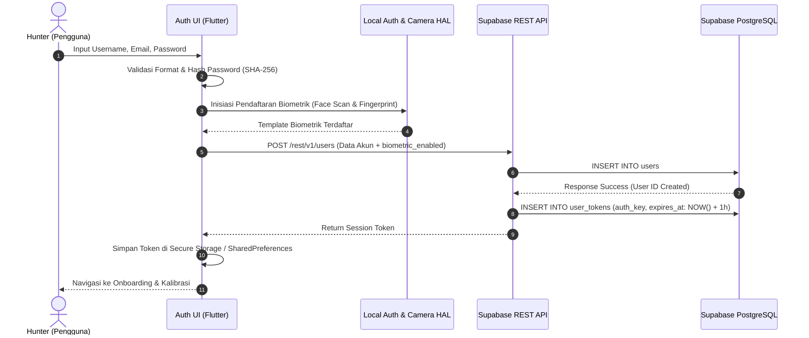

# PRODUCT REQUIREMENTS DOCUMENT (PRD) & USER FLOW
## LEVMAX: Solo Leveling Lifestyle RPG Mobile Application

---

| **Dokumen Metadata** | **Keterangan** |
|:---|:---|
| **Nama Proyek** | LevMax (Level Up to the Maximum) |
| **Konsep Produk** | Smart Lifestyle Assistant & Gamified Solo Leveling RPG |
| **Versi Dokumen** | 1.0.0 (Standard Industri / Production Ready) |
| **Target Platform** | Android (API Level 28+) & iOS (iOS 15+) |
| **Lead Architect & PM**| Principal Product Manager & Lead Systems Architect |
| **Status Dokumen** | Approved for Development & GitHub Release |

---

## 1. Overview & Tujuan Produk

### 1.1 Visi & Latar Belakang
**LevMax** adalah aplikasi manajemen gaya hidup cerdas (*lifestyle management app*) yang mentransformasi rutinitas harian pengguna—mencakup olahraga fisik, kesehatan kardiovaskular, kedisiplinan perawatan diri, hingga produktivitas belajar—menjadi petualangan *Role-Playing Game* (RPG) imersif yang terinspirasi oleh fenomena webtoon/anime global *"Solo Leveling"*.

Banyak aplikasi pelacak kebiasaan (*habit tracker*) konvensional gagal mempertahankan retensi pengguna jangka panjang akibat ketiadaan konsekuensi nyata (*stakes*), visualisasi perkembangan yang monoton, dan kemudahan bagi pengguna untuk memalsukan (*cheat*) progres mereka sendiri. LevMax menyelesaikan masalah ini dengan mengintegrasikan:
1. **Verifikasi Sensor & Computer Vision Hardware:** Pelacakan repetisi olahraga berbasis kamera (AI Pose Estimation) dan pedometer berbasis akselerometer anti-kendaraan.
2. **Psikologi Gamifikasi Konsekuensial:** Sistem HP (*Health Points*), ancaman *Penalty Zone*, dan *Game Over* permanen bagi yang melalaikan komitmen.
3. **Integritas Aset & Leaderboard (Anti-Cheat Blockchain):** Notarisasi hash kriptografi SHA-256 untuk memvalidasi kepemilikan item dan posisi peringkat kebanggaan (*Pride*).
4. **Sistem Asisten Cerdas (The System AI):** Chatbot asisten gaya hidup berkepribadian otoriter dan adaptif yang ditenagai oleh Google Generative AI (Gemini).

### 1.2 Tujuan Strategis Produk
- **Meningkatkan Konsistensi Rutinitas:** Mendorong kebiasaan harian melalui siklus harian wajib (*daily reset*) pukul 00:00 midnight.
- **Validasi Aktivitas Bebas Manipulasi:** Menghilangkan pencatatan manual palsu dengan mewajibkan interaksi sensor perangkat keras (kamera, accelerometer, gyroscope, dan GPS).
- **Menciptakan Motivasi Intrinsik & Ekstrinsik:** Mengombinasikan kenaikan Rank Hunter (F $\to$ S), perolehan Gold, koleksi item digital, hingga konversi nilai Gold ke mata uang riil (*multi-currency exchange*).

---

## 2. Arsitektur Alur Pengguna (User Flow) Hulu ke Hilir

```
[ PENGGUNA BARU ]
        │
        ▼
[ 1. AUTHENTICATION CONDUIT ]
   ├── Form Registrasi: Username, Email, Password
   ├── Pendaftaran Biometrik: Face ID (Kamera) & Fingerprint
   └── Sesi Login Berbasis Token (Expired: 1 Jam)
        │
        ▼
[ 2. ONBOARDING & PHYSICAL AWAKENING ]
   ├── Input Antropometri: Berat Badan (BB) & Tinggi Badan (TB)
   ├── Kalkulasi Otomatis Indeks Massa Tubuh (BMI)
   ├── Physical Awakening Test 1 Menit via Kamera AI (Push-up, Sit-up, Squat, Pull-up)
   └── Evaluasi Algoritmik: Penentuan Rank Awal (Maksimal Rank E)
        │
        ▼
[ 3. SYSTEM GATEWAY (MAIN TACTICAL HUD) ]
   │
   ├──► TAB 1: STATUS & QUEST (HUD Utama)
   │     ├── Ringkasan Status Hero (HP, EXP, Gold, Rank Glow)
   │     ├── Daily Quests (Workout, Cardio, Skincare, Study)
   │     ├── World Clock Multi-Timezone & Countdown Reset 00:00
   │     └── Floating Actions: AI System Chat (Gemini) & Alarm Scheduler
   │
   ├──► TAB 2: DUNGEON LBS (Peta Taktis)
   │     ├── 7 Titik Koordinat Acak Mingguan (Radius 1–5 km)
   │     └── Geofencing Klaim Mystery Gift (< 30 m): Zonk, Extra Quest, Rare Item
   │
   ├──► TAB 3: MINI-GAMES (Farming Zone)
   │     ├── Gyroscope Tilt Balance & Reflex Tap Mini-Games
   │     └── Limitasi Hadiah: Maksimal 1x Klaim Gold per Game per Hari
   │
   ├──► TAB 4: SHOP & LEADERBOARD (Guild Exchange)
   │     ├── Pembelian Consumables (HP Potion, Ticket) & Pride Items
   │     ├── Leaderboard Terenkripsi Blockchain
   │     └── Multi-Currency Converter & Simulasi Top-Up
   │
   └──► TAB 5: HUNTER PROFILE (Vessel Credentials)
         ├── Detail Statistik Atribut (STR, AGI, INT, CHA)
         ├── Biometric Conduit Switcher & Telemetry
         ├── Form Akademik: Saran & Kesan Perkuliahan Mobile
         └── Danger Conduit: Secure Logout Sequence
```

---

## 3. Spesifikasi Fungsional Layar & Alur Detail

### 3.1 Alur Registrasi, Biometrik, & Sesi Login



#### Kebutuhan Fungsional Autentikasi:
1. **Input Form Standar:**
   - Field `Username` (unik, min. 4 karakter, alphanumeric).
   - Field `Email` (validasi format email standar RFC 5322).
   - Field `Password` (min. 8 karakter, kombinasi huruf, angka, dan karakter spesial).
2. **Integrasi Sensor Biometrik:**
   - **Face ID:** Membuka kamera depan dengan overlay *Cybernetic Reticle Scan*. Menggunakan deteksi wajah untuk memverifikasi kehadiran pengguna secara langsung (*liveness detection*).
   - **Fingerprint:** Menggunakan plugin `local_auth` untuk mengakses sensor biometrik sidik jari perangkat keras (Android BiometricPrompt / iOS LocalAuthentication).
3. **Manajemen Sesi:**
   - Token sesi disimpan di `user_tokens` dengan masa kedaluwarsa 1 jam (3600 detik).
   - Fast-pass biometric login: Saat aplikasi dibuka kembali, pengguna cukup menyentuh sensor sidik jari atau memindai wajah tanpa mengetikkan ulang kata sandi.

---

### 3.2 Alur Onboarding & Kalibrasi Fisik (Awakening Test)

Layar ini merupakan fase inisiasi wajib bagi seluruh pengguna baru sebelum diizinkan mengakses fitur utama.

```mermaid
flowchart TD
    Start([Mulai Onboarding]) --> InputBody[Input Tinggi Badan (TB) & Berat Badan (BB)]
    InputBody --> CalcBMI[Kalkulasi Nilai BMI:<br/>BMI = BB / (TB/100)²]
    CalcBMI --> DisplayBMI[Tampilkan Kategori BMI & Saran Kalori]
    DisplayBMI --> CameraTest[Masuk Sesi Tes Fisik Kamera 1 Menit]
    
    subgraph TestFisik [Evaluasi Computer Vision (4x 60 Detik)]
        T1[Push-up Test - 60s]
        T2[Sit-up Test - 60s]
        T3[Squat Test - 60s]
        T4[Pull-up Test - 60s]
    end
    
    CameraTest --> T1 --> T2 --> T3 --> T4
    T4 --> EvalScore[Algoritma Evaluasi Awakening]
    
    EvalScore --> CheckCondition{BMI Normal (18.5–24.9)<br/>DAN Repetisi Rata-rata >= Threshold?}
    CheckCondition -- Ya --> AssignRankE[Tetapkan Rank Awal: RANK E<br/>Level 1 | Stat Bonus +5]
    CheckCondition -- Tidak --> AssignRankF[Tetapkan Rank Awal: RANK F<br/>Level 1 | Base Stat Default]
    
    AssignRankE --> InitBlockchain[Terbitkan Genesis Block SHA-256]
    AssignRankF --> InitBlockchain
    InitBlockchain --> ToMain[Masuk ke Main Tactical HUD]
```

#### Aturan Penilaian Rank Awal:
- **Ketentuan Mutlak:** Pengguna baru **maksimal memperoleh Rank E** pada saat kalibrasi awal. Pengguna tidak diperbolehkan langsung menempati Rank D, C, B, A, atau S demi menjaga integritas progresi gamifikasi (*anti power-creep*).
- **Threshold Rank E:**
  - Status BMI: Berada pada rentang Sehat/Normal ($18.5 \le \text{BMI} \le 24.9$).
  - Performa Tes 1 Menit:
    - Push-up $\ge 25$ repetisi valid.
    - Sit-up $\ge 25$ repetisi valid.
    - Squat $\ge 30$ repetisi valid.
    - Pull-up $\ge 6$ repetisi valid.
- Jika salah satu parameter di atas tidak terpenuhi, pemain otomatis ditetapkan sebagai **Rank F (Hunter Terlemah / Baseline)**.

---

### 3.3 Alur Utama: 5 Bottom Navigation Tabs

Aplikasi menggunakan antarmuka navigasi taktis 5-tab dengan *dark cyberpunk military aesthetic* bertema Solo Leveling.

```
┌──────────────────────────────────────────────────────────┐
│                 LEVMAX TACTICAL HUD                      │
├──────────────────────────────────────────────────────────┤
│                                                          │
│                     [ ACTIVE VIEW ]                      │
│                                                          │
├──────────────────────────────────────────────────────────┤
│  [QUESTS]   [DUNGEON]   [GAMES]    [SHOP]     [PROFILE]  │
│    Tab 1      Tab 2      Tab 3      Tab 4      Tab 5     │
└──────────────────────────────────────────────────────────┘
```

#### 1. Tab Quest (Halaman Utama / Status Window)
- **Header Profil Hunter:**
  - Menampilkan Avatar digital, Username, Rank Badge (Frame Glow dinamis sesuai Rank: F abu-abu, E cokelat perunggu, D hijau, C biru, B ungu neon, A emas, S merah darah/crimson neon).
  - Indikator vital real-time: **HP Bar (0–100)** dan **EXP Bar (0–100)**.
  - Tampilan saldo Gold Vault.
- **Sistem Quest Harian Berbasis Sensor & Interaksi:**
  - **Workout (Physical Strength):** Pelacakan gerakan via Kamera AI / Pose Estimation. Pengguna meletakkan perangkat menghadap tubuh; sistem menghitung sudut fleksi sendi untuk memvalidasi repetisi Push-up, Sit-up, dan Squat secara presisi.
  - **Cardio (Endurance):** Menggunakan integrasi Pedometer & Akselerometer perangkat keras. Menghitung langkah kaki (*step counter*) dan jarak tempuh. Dilengkapi algoritma *anti-cheat velocity gating* untuk menolak data jika kecepatan terdeteksi melebihi batas manusia wajar ($> 25\text{ km/jam}$).
  - **Appearance / Skincare (Charisma):** Modal *Draggable Bottom Sheet* yang memuat daftar periksa (*checkboxes*) kebiasaan perawatan diri (misal: cuci muka, tabir surya/sunscreen pagi, hidrasi air 2 liter, dan rutinitas malam).
  - **Study / Deep Work (Intelligence):** Timer fokus terintegrasi sensor giroskop (mendeteksi kemiringan smartphone agar pengguna tidak tertunduk leher / *text-neck*). Di akhir sesi materi, pengguna wajib menyelesaikan **Trivia Quiz** untuk mencairkan perolehan EXP.
- **Widget Utilitas Sistem:**
  - **Daily Reset Countdown Timer:** Tampilan hitung mundur presisi menuju pukul 00:00 midnight waktu server lokal (WIB UTC+7). Saat waktu habis, seluruh quest yang belum berstatus `is_completed` akan dievaluasi oleh sistem penalti.
  - **World Clock Converter:** Tampilan sinkron 4 zona waktu strategis:
    - WIB (Waktu Indonesia Barat - Jakarta) [UTC+7]
    - WITA (Waktu Indonesia Tengah - Denpasar) [UTC+8]
    - WIT (Waktu Indonesia Timur - Jayapura) [UTC+9]
    - London (Greenwich Mean Time / BST) [UTC+0 / UTC+1]
  - **Dual Tactical Floating Action Buttons (FAB):**
    - **FAB AI Assistant ("The System"):** Membuka dialog interaktif dengan *System AI* berbasis Google Generative AI (Gemini Pro) yang memberikan evaluasi gaya hidup, saran latihan, serta respon dingin penuh otoritas ala *The System* Solo Leveling.
    - **FAB Alarm & Reminder Scheduler:** Mengatur pengingat lokal via `flutter_local_notifications` untuk jam latihan, jadwal minum air, dan batas waktu penyelesaian quest harian.

---

#### 2. Tab LBS (Dungeon Map / Location-Based Services)
- **Visualisasi Peta Taktis:** Menggunakan `flutter_map` dengan koordinat GPS real-time pengguna via `geolocator`. Peta disajikan dalam gaya *dark tactical radar*.
- **Procedural Dungeon Gate Generation:**
  - Setiap minggu (reset Senin 00:00), sistem secara otomatis memetakan **7 titik koordinat acak** (Dungeon Gates) dalam radius 1 hingga 5 kilometer di sekitar lokasi pengguna.
- **Geofencing & Klaim Mystery Gift:**
  - Pengguna harus bergerak secara fisik mendekati salah satu titik koordinat (radius klaim: $< 30\text{ meter}$).
  - Tombol *"EXTRACT DUNGEON CORE"* akan aktif saat berada di dalam radius.
  - Peluang Hasil *Mystery Gift*:
    - **Zonk / Trap (35%):** Memicu jebakan dungeon (Mini survival tap-challenge atau tanpa hadiah).
    - **Hidden Quest (40%):** Membuka quest rahasia berhadiah EXP dan Gold berlipat ganda.
    - **Rare Item / Key (25%):** Menghasilkan item fisik langka seperti *HP Elixir* atau *Mystery Quest Ticket*.

---

#### 3. Tab Mini-Games (Farming Zone)
- **Tujuan:** Sarana *farming* Gold tambahan bagi Hunter di luar quest rutin harian.
- **Koleksi Game:**
  1. **Gyroscope Balance / Core Guardian:** Menggunakan sensor Gyroscope perangkat mobile. Pengguna harus memiringkan (*tilt*) smartphone untuk menyeimbangkan bola energi pada lintasan sempit selama 30 detik tanpa terjatuh.
  2. **Reflex Tap Strike:** Menguji kelincahan dengan mengetuk reticle sasaran dungeon yang muncul secara acak dalam pecahan detik.
- **Aturan Batasan Hadiah (*Anti-Abuse Cap*):**
  - Pemain bebas memainkan game berulang kali untuk mencetak skor tertinggi (*High Score*).
  - Namun, **hadiah Gold hanya diberikan 1 kali per hari untuk kemenangan pertama di masing-masing game**. Kemenangan berikutnya pada hari yang sama hanya mencatat riwayat skor tanpa menambah saldo Gold.

---

#### 4. Tab Shop & Leaderboard (Guild Exchange & Pride Hall)
- **Guild Shop (Katalog Item):**
  - **Consumables:**
    - *Lesser HP Potion* (+20 HP) – 150 Gold
    - *Full Recovery Elixir* (+100 HP) – 600 Gold
    - *Quest Rollover Ticket* (Mencegah penalti 1 quest) – 400 Gold
    - *Mystery Dungeon Key* (Akses Mystery Quest) – 500 Gold
  - **Pride / Collector Items (Koleksi Bergengsi):**
    - *Demon Monarch's Dagger* (+150 Pride Points) – 2.500 Gold
    - *Shadow Sovereign Cloak* (+350 Pride Points) – 5.000 Gold
    - *Orb of Avarice* (+800 Pride Points) – 10.000 Gold
- **Sistem Leaderboard Berbasis Rantai Kriptografi:**
  - Peringkat ditentukan oleh akumulasi *Pride Points* dari Koleksi Item.
  - Setiap pembelian item koleksi diverifikasi dan dicatat ke dalam *Blockchain Ledger* agar posisi klasemen bersifat mutlak dan tidak dapat direkayasa.
- **Kalkulator Kurs Real-Time (Guild Currency Exchange):**
  - Mengonversi nilai Gold virtual ke estimasi mata uang riil:
    - $1\text{ Gold} = \text{Rp } 1.000\text{ IDR}$
    - Kurs dinamis ke USD (\$1 = Rp 15.500) dan EUR (€1 = Rp 16.800).
- **Conduit Top-Up Gold:**
  - Mock payment gateway untuk simulasi pengisian saldo Gold menggunakan kupon guild atau top-up digital.

---

#### 5. Tab Profil (Vessel Credentials & Academics)
- **Identitas Hunter & Visual Rank:**
  - Kartu identitas taktis memuat Nama, Gelar (*The Monarch*), Tanggal Kebangkitan (*Awakened Date*), dan Avatar berbingkai *Dynamic Neon Glow*.
  - Tampilan visual statistik detail: Total Repetisi Latihan, Jarak Lari Kumulatif, Tingkat Penyelesaian Quest, dan Riwayat Penalti.
- **Radar Statistik Atribut:**
  - Visualisasi 4 pilar kekuatan karakter: **STR** (Kekuatan), **AGI** (Kelincahan), **INT** (Kepintaran), dan **CHA** (Kharisma).
- **Biometric Security Conduit:**
  - Tombol sakelar (*toggle*) untuk mengaktifkan/menonaktifkan Face ID dan Sensor Sidik Jari.
  - Kalibrasi ulang biometrik jika perangkat berpindah kepemilikan.
- **Formulir Kesan & Pesan Kuliah Mobile:**
  - Form wajib akademik: Input NIM, Nama Mahasiswa, Kesan Perkuliahan, dan Saran Perbaikan untuk mata kuliah Pemrograman Aplikasi Mobile.
  - Data tersinkronisasi langsung ke tabel `saran_kesan` di Supabase.
- **Danger Zone / Logout:**
  - Menghentikan sesi aktif, mencabut token autentikasi di Supabase `user_tokens`, dan membersihkan cache lokal Hive secara aman.
