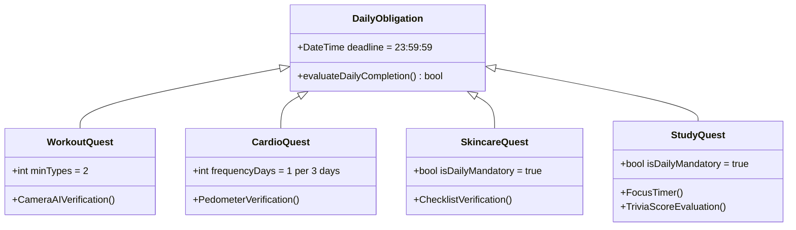
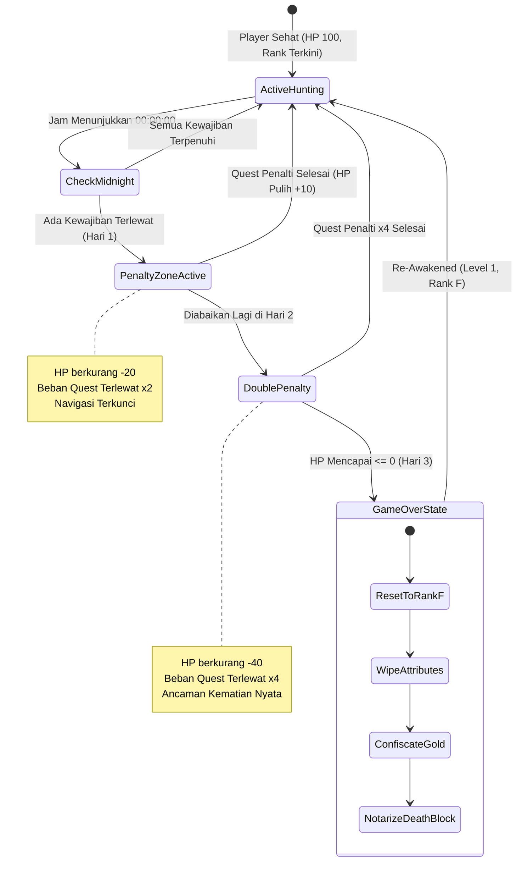

# LOGIKA GAMIFIKASI & ATURAN PENALTI (GAME RULES & BALANCING)
## LEVMAX: Solo Leveling Lifestyle RPG Mobile Application

---

| **Dokumen Metadata** | **Keterangan** |
|:---|:---|
| **Nama Proyek** | LevMax (Level Up to the Maximum) |
| **Topik Dokumen** | Game Mechanics, Attribute Progression, Daily Quotas, & Penalty Balancing |
| **Versi Dokumen** | 1.0.0 (Standard Industri / Production Ready) |
| **Fokus Teknis** | State Machine, Formula Matematika Game, & Anti-Exploit Balancing |
| **Lead Architect & PM**| Principal Product Manager & Lead Systems Architect |
| **Status Dokumen** | Approved for Development & GitHub Release |

---

## 1. Sistem Atribut & Logika Kenaikan Rank (Rank-Up Paradigm)

### 1.1 Empat Pilar Atribut Karakter
Karakter Hunter di dalam LevMax didefinisikan oleh empat atribut fundamental yang merefleksikan kedisiplinan hidup nyata pengguna:

```
                  ┌───────────────────────────────┐
                  │      HUNTER ATTRIBUTES        │
                  └──────────────┬────────────────┘
                                 │
     ┌───────────────────┬───────┴───────────┬───────────────────┐
     ▼                   ▼                   ▼                   ▼
  [ STR ]             [ AGI ]             [ INT ]             [ CHA ]
  STRENGTH            AGILITY          INTELLIGENCE         CHARISMA
  Olahraga Fisik     Cardio & Langkah    Studi & Kuis      Skincare & Habit
  (Push/Pull/Squat)  (Pedometer 72h)    (Trivia Mastery)  (Checklist Grooming)
```

1. **Strength (STR) – Kekuatan Fisik:**
   - **Aktivitas Pendorong:** Workout fisik berbasis kamera AI (Push-up, Pull-up, Sit-up, Squat).
   - **Pengaruh Dalam Game:** Meningkatkan nilai *Attack Damage* saat menghadapi rintangan dungeon LBS dan mempercepat penyelesaian mini-game berbasis kekuatan.
2. **Agility (AGI) – Kelincahan & Ketahanan:**
   - **Aktivitas Pendorong:** Cardio harian, lari, jalan cepat, dan akumulasi langkah kaki pedometer.
   - **Pengaruh Dalam Game:** Memperlebar *reaction window* pada mini-game refleks dan meningkatkan kecepatan akumulasi Gold pada aktivitas berbasis GPS.
3. **Intelligence (INT) – Kepintaran & Ketajaman Mental:**
   - **Aktivitas Pendorong:** Sesi belajar mendalam (*Deep Work Focus Timer*) dan penyelesaian Trivia Quiz harian.
   - **Pengaruh Dalam Game:** Memberikan pengganda (*multiplier*) perolehan EXP harian dan membuka petunjuk strategi dari System AI.
4. **Charisma (CHA) – Daya Tarik & Disiplin Pribadi:**
   - **Aktivitas Pendorong:** Kedisiplinan rutinitas perawatan diri (*appearance/skincare checklist*) dan pemeliharaan *streak* aktif tanpa putus.
   - **Pengaruh Dalam Game:** Memberikan diskon harga pembelian item di Guild Shop serta bonus nilai tukar pada kalkulator kurs Gold.

---

### 1.2 Formula Kenaikan Level (Level Up)
Pengguna mengumpulkan Experience Points (EXP) melalui penyelesaian quest. Setiap akumulasi mencapai batas formula:

$$\text{EXP}_{\text{required}} = 100 \times \text{Current Level}$$

Setiap kali $\text{Current EXP} \ge \text{EXP}_{\text{required}}$, terjadi peristiwa **Level Up**:
- $\text{Level} \leftarrow \text{Level} + 1$
- $\text{EXP} \leftarrow \text{EXP} - \text{EXP}_{\text{required}}$
- Pemain mendapatkan 4 Stat Points bebas yang dialokasikan otomatis sesuai performa quest tertinggi hari itu (+1 pada masing-masing atribut terkait).

---

### 1.3 Syarat Mutlak Kenaikan Rank (Balanced Stat Check)
Di dunia LevMax, seorang Hunter **TIDAK DAPAT** naik ke Rank berikutnya hanya dengan menimbun EXP atau hanya melatih satu jenis aktivitas (misalnya hanya olahraga fisik tanpa pernah belajar, atau hanya belajar tanpa pernah berolahraga). 

Kenaikan Rank mensyaratkan dua kondisi logis konjungtif ($A \land B$):

$$\text{Eligible For Rank Up} \iff (\text{Level} \ge \text{Min Level}) \land \left( \min(\text{STR}, \text{AGI}, \text{INT}, \text{CHA}) \ge \text{Threshold}_{\text{Rank}} \right)$$

#### Matriks Kenaikan Rank & Ambang Batas Keseimbangan Stat:

| Rank Target | Level Minimum | Min STR | Min AGI | Min INT | Min CHA | Evaluasi Keseimbangan | Efek Visual Badge |
|:---:|:---:|:---:|:---:|:---:|:---:|:---|:---|
| **Rank F** | 1 | 5 | 5 | 5 | 5 | Baseline Hunter Terlemah | Grey Muted Border |
| **Rank E** | 6 | 20 | 20 | 20 | 20 | Fondasi Dasar Tercapai | Bronze Metallic Outline |
| **Rank D** | 16 | 45 | 45 | 45 | 45 | Disiplin Mulai Terbentuk | Emerald Green Neon |
| **Rank C** | 31 | 75 | 75 | 75 | 75 | Kebiasaan Gaya Hidup Mantap | Cyan Electric Pulse |
| **Rank B** | 51 | 115 | 115 | 115 | 115 | Tingkat Menengah Atas | Deep Violet Neon Glow |
| **Rank A** | 71 | 165 | 165 | 165 | 165 | Elite Disciplined Hunter | Radiant Gold Aura |
| **Rank S** | 91+ | 225 | 225 | 225 | 225 | National Level / Monarch | Crimson Blood Strobe |

#### Kasus Penalti "Stagnasi Pertumbuhan" (Capped EXP):
Jika seorang Hunter mencapai EXP maksimum untuk naik rank namun salah satu atribut berada di bawah ambang batas minimum:
- Status Karakter: **RANK UP BLOCKED: IMBALANCED VESSEL**.
- EXP terkunci pada angka $99\%$ dari ambang batas level tersebut.
- Seluruh sisa EXP yang didapat dari quest berikutnya akan hangus (*wasted*) sampai pemain meningkatkan atribut terlemahnya melalui quest yang relevan.

---

## 2. Aturan Penyelesaian Quest Harian (Daily Obligations)

Setiap hari kalender (pukul 00:00:00 hingga 23:59:59 waktu lokal), sistem menerbitkan serangkaian mandat harian yang terbagi dalam **4 Kategori Wajib**:



### 2.1 Rincian Matriks Kewajiban Harian:

| Kategori | Frekuensi Wajib | Metode Verifikasi Hardware | Tolok Ukur Keberhasilan | Reward Dasar |
|:---|:---|:---|:---|:---|
| **1. Workout (WO)** | Wajib Setiap Hari | Kamera AI (Pose Tracking) | **Minimal 2 jenis latihan berbeda** per hari (misal: Push-up + Squat) dengan repetisi penuh | +25 EXP, +30 Gold, +2 STR |
| **2. Cardio** | **Minimal 1x dalam 3 hari** (Rolling 72 Jam) | Accelerometer + Pedometer | Akumulasi minimal **3.500 langkah** atau lari **2,0 km** pada hari pelaksanaan | +30 EXP, +35 Gold, +3 AGI |
| **3. Appearance** | Wajib Setiap Hari | Bottom Sheet Checklist | Melakukan verifikasi checklist rutinitas pagi (Sunscreen/Grooming) dan malam (Cuci muka/Moisturizer) | +15 EXP, +15 Gold, +2 CHA |
| **4. Study / Trivia**| Wajib Setiap Hari | Focus Timer + In-App Quiz | Selesai sesi fokus minimal 30 menit **DAN** menjawab Trivia Quiz materi di akhir sesi | Skor Kuis menentukan % EXP final |

### 2.2 Mekanisme Scoring Kuis Study:
EXP dari kategori Study dihitung berdasarkan tingkat akurasi pada kuis pemahaman materi:

$$\text{EXP}_{\text{Study}} = \text{Base EXP (40)} \times \left( \frac{\text{Correct Answers}}{\text{Total Questions}} \right)$$

- Akurasi $100\%$: $+40\text{ EXP}, +25\text{ Gold}, +3\text{ INT}$
- Akurasi $75\% - 99\%$: $+30\text{ EXP}, +15\text{ Gold}, +2\text{ INT}$
- Akurasi $50\% - 74\%$: $+20\text{ EXP}, +10\text{ Gold}, +1\text{ INT}$
- Akurasi $< 50\%$: **QUEST STATUS: FAILED (Belajar Ulang)**. Pengguna harus meninjau materi kembali selama 10 menit sebelum diizinkan mengulang kuis agar quest berstatus *Complete*.

---

## 3. Mekanisme Penalti & Game Over (The Wrath of The System)



### 3.1 Pemicu Pergantian Hari & Pemotongan HP
Tepat pada pukul 00:00:00 waktu server, sebuah rutinitas pengecekan dijalankan:
1. Sistem mengecek status penyelesaian 4 pilar kewajiban hari sebelumnya.
2. Jika ditemukan pelanggaran (misalnya: Workout hanya 1 jenis, atau Skincare diabaikan, atau Cardio belum dilakukan dalam kurun 3 hari terakhir):
   - Health Points (HP) langsung dipotong sebesar **-20 HP** (pada pelanggaran pertama).
   - Flag `is_penalty_active` pada tabel `users` diset menjadi `TRUE`.
   - Notifikasi lokal darurat berdering dengan peringatan: *"PERINGATAN SISTEM: ANDA GAGAL MENYELESAIKAN QUEST HARIAN. PENALTY ZONE DIAKTIFKAN."*

---

### 3.2 Prosedur Pengalihan Paksa (Forced Penalty Zone)
Ketika aplikasi dibuka pertama kali di hari terjadinya penalti:
1. **Navigasi 5 Tab Terkunci Total:** Pengguna tidak dapat membuka Tab Dungeon, Mini-Games, Shop, maupun Profile.
2. **Forced Redirect:** Aplikasi langsung mengarahkan tampilan ke `PenaltyGamePage` / Halaman Penalti.
3. **Aturan Pelipatgandaan Beban (Multiplier x2, x4, dst):**
   - Beban quest yang dilalaikan pada hari sebelumnya **dikalikan dua (x2)** dan wajib dituntaskan di dalam Penalty Zone sebelum jam 23:59 hari tersebut.
   - *Contoh Kasus:* Pengguna kemarin melalaikan 50x Push-up. Maka di Halaman Penalti, pengguna diwajibkan menyelesaikan **100x Push-up** terpandu sensor atau menyelesaikan *Survival Poison Centipede Mini-Game* sebanyak repetisi penalti.
4. **Eskalasi Pelanggaran Berulang:**
   - **Hari Penalti ke-1 diabaikan:** HP terpotong tambahan -40 HP (Sisa HP: 40). Beban penalti berlipat menjadi **x4**.
   - **Hari Penalti ke-2 diabaikan:** HP terpotong tambahan -80 HP $\implies \mathbf{HP \le 0}$.

---

### 3.3 Sistem Game Over & Re-Awakening Reset
Jika HP pengguna menyentuh angka **0 (Nol)** akibat pengabaian quest berturut-turut:
1. **Aktivasi Layar Game Over (`GameOverPage`):**
   - Menampilkan visual ikonik dialog Solo Leveling: *"ANDA DINYATAKAN TIDAK LAYAK SEBAGAI PLAYER"*.
   - Seluruh suara aplikasi berganti menjadi efek audio sirene darurat.
2. **Sanksi Reset Akun Permanen:**
   - **Rank Demotion:** Rank diturunkan secara paksa kembali ke **Rank Terbawah (Rank F)**, terlepas dari apakah sebelumnya pemain sudah mencapai Rank A atau B.
   - **Level & EXP Reset:** Level di-reset menjadi **Level 1**, dan akumulasi EXP dikembalikan ke **0**.
   - **Penyitaan Aset:** $50\%$ saldo Gold di dalam Vault disita oleh Sistem sebagai denda pelanggaran guild.
   - **Atribut Baseline:** Atribut STR, AGI, INT, CHA dikembalikan ke nilai dasar kalibrasi awal.
3. **Pencatatan Audit Trail Blockchain:**
   - Peristiwa kematian dicatat secara permanen pada rantai blok SHA-256 lokal dan Supabase:
     ```json
     {
       "event": "GAME_OVER_RESET",
       "reason": "HP_DEPLETED_ZERO_PENALTY_IGNORED",
       "previous_rank": "Rank B",
       "new_rank": "Rank F",
       "timestamp": "2026-10-22T00:00:01Z"
     }
     ```
   - Catatan ini tidak dapat dihapus, berfungsi sebagai noda permanen dalam riwayat Hunter.

---

## 4. Sistem Mystery Quest (Elite Gate Exploration)

### 4.1 Syarat Pembukaan (Prerequisites)
Mystery Quest adalah quest elit dengan hadiah masif yang tersembunyi di balik gerbang tak terduga. Untuk dapat membukanya, pemain wajib memenuhi **3 Syarat Mutlak**:
1. **Penyelesaian Quest Harian 100%:** Seluruh 4 kategori quest utama pada hari itu telah selesai (`is_completed = true`). Pemain yang memiliki hutang penalti tidak diizinkan mengambil Mystery Quest.
2. **Kepemilikan Tiket Khusus:** Memiliki minimal 1 buah **Mystery Quest Ticket / Dungeon Key**.
3. **Batas Limit Harian:** Maksimal hanya dapat mengambil **1 Mystery Quest per hari**.

```
[ Semua 4 Quest Harian Selesai ] ─┐
                                 ├─► [ SYARAT MEMENUHI ] ─► [ BUKA MYSTERY QUEST ]
[ Memiliki Mystery Ticket / Key ] ─┤                             (Maks. 1x / Hari)
                                 │
[ Belum Ambil Mystery Hari Ini ] ─┘
```

---

### 4.2 Kuota & Metode Akuisisi Tiket
Sistem menerapkan kuota ketat untuk menjaga keseimbangan ekonomi game (*game economy balancing*):
- **Batas Kuota Mingguan:** Maksimal penyelesaian **3 tiket Mystery Quest per minggu** per akun.
- **Tiga Jalur Memperoleh Tiket:**
  1. **LBS Dungeon Map Drop:** Mengunjungi titik koordinat acak pada Tab Dungeon dan mengekstrak *Mystery Gift* dengan probabilitas keberhasilan $25\%$.
  2. **Mini-Game Flawless Victory:** Mencapai skor sempurna (*Perfect Streak*) pada mini-game Gyroscope Balance harian.
  3. **Pembelian di Guild Shop:** Membeli *Dungeon Key* menggunakan 500 Gold (dibatasi 1x beli per 3 hari).

---

### 4.3 Karakteristik & Reward Mystery Quest
Tantangan Mystery Quest dirancang memiliki tingkat kesulitan jauh lebih tinggi (*high-risk high-reward*):
- **Tipe Tantangan:** Kombinasi *Hybrid Protocol* (misal: Sprint 2 km dalam 10 menit + 50x Burpees + 5 Soal Trivia Tingkat Sulit bertema sains/teknologi).
- **Struktur Reward:**
  - $3\times$ EXP dari Quest Normal ($+100\text{ EXP}$).
  - $5\times$ Gold dari Quest Normal ($+150\text{ Gold}$).
  - Kesempatan mendapatkan *Rare Collector Artifact* untuk mendongkrak posisi di Leaderboard Blockchain.
