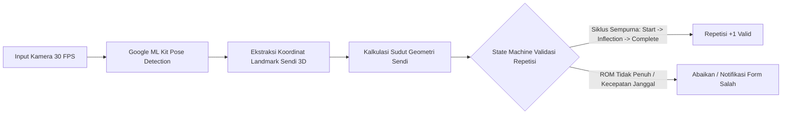
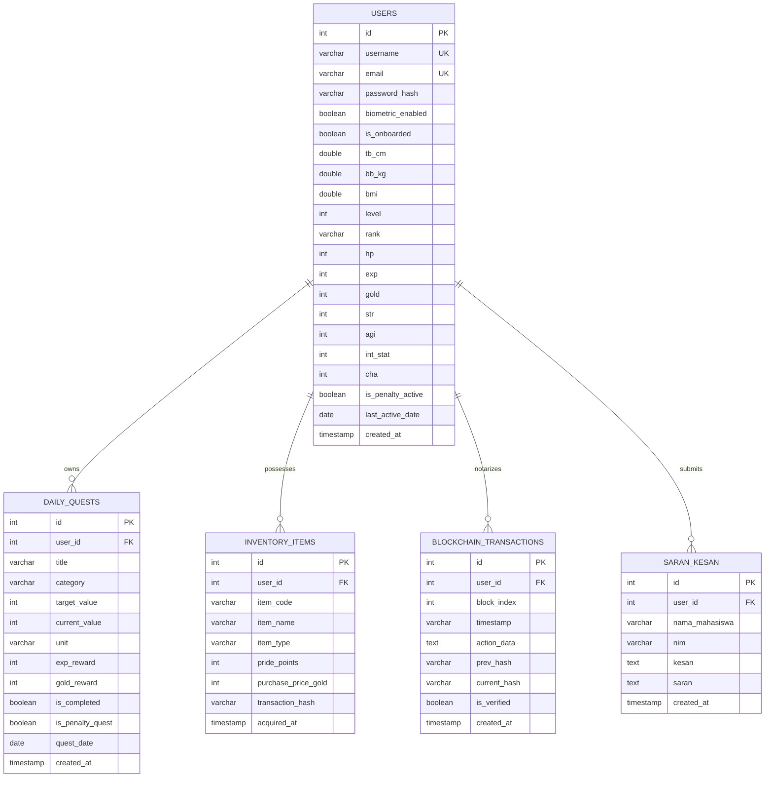

# ARSITEKTUR TEKNIS & STRUKTUR DATA (TECHNICAL ARCHITECTURE & DATABASE)
## LEVMAX: Solo Leveling Lifestyle RPG Mobile Application

---

| **Dokumen Metadata** | **Keterangan** |
|:---|:---|
| **Nama Proyek** | LevMax (Level Up to the Maximum) |
| **Topik Dokumen** | System Architecture, Hardware HAL, Anti-Cheat Blockchain, & Database Schema |
| **Versi Dokumen** | 1.0.0 (Standard Industri / Production Ready) |
| **Target Lingkungan** | Client-Side Flutter, Edge Supabase PostgREST, & Local Hive NoSQL |
| **Lead Architect & PM**| Principal Product Manager & Lead Systems Architect |
| **Status Dokumen** | Approved for Development & GitHub Release |

---

## 1. Arsitektur Perangkat Lunak & Tech Stack

Sistem LevMax dirancang dengan mengadopsi arsitektur tiga tingkat (*3-Tier Hybrid Architecture*): **Client Layer (Mobile Application)**, **Offline Persistence Layer (Local Cache & Blockchain)**, dan **Cloud Synchronization Layer (Supabase BaaS & AI Engine)**.

```
┌────────────────────────────────────────────────────────────────────────┐
│                   CLIENT TIER (FLUTTER CROSS-PLATFORM)                 │
│                                                                        │
│   [ Presentation Layer: Tactical Stitch HUD UI / Material 3 ]          │
│   [ Business Logic: Providers / Services / Anti-Cheat Engines ]        │
│   [ Hardware Abstraction Layer (HAL): Camera, Sensors, Biometrics ]    │
└──────────────────┬─────────────────────────────────┬───────────────────┘
                   │                                 │
                   ▼ (Synchronous I/O)               ▼ (Asynchronous HTTPS / WSS)
┌──────────────────────────────────────┐  ┌──────────────────────────────┐
│       OFFLINE PERSISTENCE TIER       │  │        CLOUD EDGE TIER       │
│                                      │  │                              │
│   • Hive NoSQL Binary Storage        │  │   • Supabase PostgreSQL 15   │
│     - QuestBox (Quests Cache)        │  │     - Relational Tables      │
│     - PlayerBox (Offline Stats)      │  │     - RLS & Sesi Auth Tokens │
│     - BlockchainBox (SHA-256 Ledger) │  │   • Google Generative AI     │
│   • Flutter Secure Storage (Keys)    │  │     - Gemini Pro System AI   │
└──────────────────────────────────────┘  └──────────────────────────────┘
```

### 1.1 Rincian Tech Stack Inti:

1. **Frontend & Mobile Runtime:**
   - **Flutter Framework (v3.13+ / Dart v3.1+):** Menghasilkan kompilasi native ARM64 untuk Android dan iOS dengan performa rendering 60/120 FPS menggunakan engine Impeller/Skia.
   - **Google Fonts (Cinzel, Orbitron, JetBrains Mono):** Menyajikan tipografi bergaya *military-grade sci-fi HUD* khas Solo Leveling.
2. **Backend as a Service (BaaS) & Cloud Database:**
   - **Supabase Cloud (PostgreSQL 15):** Bertindak sebagai database relasional utama, penyedia otentikasi RESTful via PostgREST, serta sinkronisasi data online.
   - **Supabase API Client (`http` / `supabase_flutter`):** Mengelola pertukaran payload JSON terenkripsi dan token sesi.
3. **Local Storage & Offline-First Strategy:**
   - **Hive (v2.2.3):** Database key-value NoSQL berbasis biner murni yang ditulis dalam Dart murni. Dipilih karena kecepatan baca-tulis ultra cepat ($< 15\text{ ms}$) tanpa overhead SQLite, ideal untuk menyimpan riwayat sensor per detik dan rantai blok lokal.
   - **SharedPreferences:** Menyimpan preferensi aplikasi ringan seperti status audio, haptic, dan user ID aktif.
4. **Kecerdasan Buatan (Conversational AI):**
   - **Google Generative AI (`google_generative_ai`):** Model Gemini Pro yang diinstruksikan melalui *system prompt* khusus untuk bertindak sebagai *The System Architect* (dingin, lugas, mengintimidasi namun memotivasi pemain).
5. **Keamanan Perangkat Keras (Hardware Security):**
   - **`local_auth` (v2.3.0):** Akses biometrik native tingkat perangkat keras (Android BiometricManager & iOS LAContext).
   - **`crypto` (v3.0.5):** Implementasi algoritma hash kriptografis SHA-256 murni.

---

## 2. Integrasi Hardware Khusus & Validasi Anti-Cheat

Aplikasi gaya hidup konvensional mudah dimanipulasi dengan sekadar menekan tombol *"Selesai"*. LevMax mengintegrasikan sensor perangkat keras mobile secara mendalam untuk menjamin keaslian data aktivitas:

```
[ HARDWARE SENSORS ]
  ├── 1. KAMERA (Camera API + ML Kit) ──► Pose Estimation (Hitung Repetisi Olahraga)
  ├── 2. ACCELEROMETER (sensors_plus) ──► Pedometer & Deteksi Pola Langkah Kaki
  ├── 3. GPS GEOLOCATOR (geolocator)  ──► Kecepatan Tempuh (Blokir Kendaraan Bermotor)
  └── 4. GYROSCOPE (sensors_plus)     ──► Mini-Game Tilt & Sensor Postur Leher
```

---

### 2.1 Computer Vision: AI Pose Estimation via Kamera
Digunakan pada **Awakening Test Onboarding** dan **Daily Workout Quests** (Push-up, Sit-up, Squat, Pull-up).



#### Algoritma Penghitungan Repetisi Berbasis Sudut Sendi:
Kamera melacak koordinat tiga titik sendi $(A, B, C)$ pada ruang 2D/3D. Sudut sendi $\theta$ dihitung menggunakan perkalian titik (*dot product*) vektor:

$$\mathbf{u} = \vec{BA} = A - B, \quad \mathbf{v} = \vec{BC} = C - B$$

$$\theta = \arccos\left( \frac{\mathbf{u} \cdot \mathbf{v}}{\|\mathbf{u}\| \|\mathbf{v}\|} \right) \times \frac{180^\circ}{\pi}$$

#### Kriteria Ambang Batas Gerakan Valid:
1. **Push-up:** Sudut siku (Bahu - Siku - Pergelangan Tangan).
   - *State Down (Infleksi):* $\theta \le 90^\circ$ (dada mendekati lantai).
   - *State Up (Selesai):* $\theta \ge 160^\circ$ (tangan lurus).
2. **Squat:** Sudut lutut (Pinggul - Lutut - Pergelangan Kaki).
   - *State Down:* $\theta \le 90^\circ$ (paha sejajar lantai).
   - *State Up:* $\theta \ge 165^\circ$ (berdiri tegak).
3. **Anti-Cheat Validation:**
   - **Minimal Rep Duration:** Durasi 1 repetisi penuh harus berada pada rentang $0.8\text{ detik} \le t \le 5.0\text{ detik}$. Gerakan yang terjadi di bawah 0.8 detik ditolak karena dianggap getaran atau *camera shaking cheat*.
   - **Body Presence Gating:** Repetisi tidak dihitung jika confidence score landmark sendi $< 0.75$.

---

### 2.2 Accelerometer & Pedometer: Verifikasi Cardio Anti-Kendaraan
Digunakan untuk memastikan pengguna benar-benar berjalan kaki atau berlari saat menuntaskan quest Cardio.

#### Mekanisme Validasi Fusi Sensor (Dual-Sensor Fusion):
1. **Deteksi Langkah (Accelerometer Step Counter):**
   - Mengambil data akselerasi linear dari `UserAccelerometerEvent` (bebas gravitasi):
     $$\|a\| = \sqrt{a_x^2 + a_y^2 + a_z^2}$$
   - Dilakukan penyaringan frekuensi (*Low-Pass Filter*) untuk membuang *high-frequency noise*.
   - Langkah dihitung saat sinyal melewati ambang batas puncak (*peak detection*) dengan frekuensi alami jalan kaki manusia ($1.5\text{ Hz} \le f \le 3.5\text{ Hz}$).
2. **Pengecekan Kecepatan GPS (Vehicle Anti-Cheat Guard):**
   - Mengambil kecepatan instan dari sensor GPS: $v = \text{position.speed}$ (dalam $\text{m/s}$ atau $\text{km/jam}$).
   - **Aturan Pemblokiran Kendaraan:**
     $$v_{\text{max}} = 25.0\text{ km/jam}$$
     Jika sistem mendeteksi kecepatan $v > v_{\text{max}}$ selama lebih dari 10 detik berturut-turut:
     - Pelacakan langkah otomatis **dihentikan seketika (*frozen*)**.
     - Status Quest: *"SUSPICIOUS VELOCITY DETECTED: CAR/MOTORBIKE SUSPECTED"*.
     - Jarak yang ditempuh selama periode kecepatan tinggi tersebut dianulir (tidak dihitung).

---

### 2.3 Gyroscope: Kontrol Mini-Game & Sensor Postur Leher
- Mengakses sensor `GyroscopeEvent` yang membaca laju rotasi sudut perangkat ($\text{rad/s}$) pada sumbu Roll ($x$), Pitch ($y$), dan Yaw ($z$).
- **Mini-Game Tilt Balance:**
  - Posisi bola $(P_x, P_y)$ pada canvas antarmuka dihitung secara dinamis:
    $$P_x(t + \Delta t) = P_x(t) + (\omega_y \times \text{Sensitivity} \times \Delta t)$$
    $$P_y(t + \Delta t) = P_y(t) + (\omega_x \times \text{Sensitivity} \times \Delta t)$$
  - Pemain harus menjaga koordinat bola tetap berada dalam *Safe Containment Radius* selama 30 detik.
- **Sensor Postur Belajar (Nerd-Neck Protector):**
  - Mengukur sudut elevasi smartphone saat quest Study berjalan. Jika perangkat diletakkan pada posisi mendatar di meja sementara kepala menunduk drastis, notifikasi peringatan postur diaktifkan.

---

## 3. Sistem Blockchain Anti-Cheat (Koleksi Item & Leaderboard)

### 3.1 Latar Belakang & Masalah
Pada aplikasi mobile yang memiliki fitur kompetisi atau papan peringkat (*Leaderboard*), kerentanan terbesar adalah manipulasi memori lokal (*memory tampering*) menggunakan perangkat yang di-*root* atau *jailbreak*. Pengguna nakal dapat mengubah nilai saldo Gold lokal atau memalsukan kepemilikan item langka untuk merajai Leaderboard.

Untuk memitigasi kerentanan ini, LevMax menerapkan arsitektur **Ledger Kriptografi SHA-256 (Private Lightweight Blockchain)** yang menghubungkan setiap peristiwa perolehan dan pembelian item ke dalam rantai blok terenkripsi yang tidak dapat diubah (*tamper-evident*).

```
┌─────────────────────────────────┐       ┌─────────────────────────────────┐
│          BLOCK N - 1            │       │             BLOCK N             │
├─────────────────────────────────┤       ├─────────────────────────────────┤
│ Index: 14                       │       │ Index: 15                       │
│ Timestamp: 2026-10-22T10:15:00Z │       │ Timestamp: 2026-10-22T12:00:00Z │
│ Action: "BUY: Monarch Dagger"   │       │ Action: "BUY: Sovereign Cloak"  │
│ PrevHash: a8f9c1...             │       │ PrevHash: 3b4c9e... ◄───────────┼──┐
│ CurrentHash: 3b4c9e... ─────────┼───────► CurrentHash: f4e21a...           │  │
└─────────────────────────────────┘       └─────────────────────────────────┘  │
                                                                               │
                 [ VERIFIKASI IDENTITAS RANTAI BLOK ]                          │
                 CurrentHash(N-1) == PrevHash(N) ──────────────────────────────┘
```

---

### 3.2 Struktur Data `LedgerBlock`
Setiap blok di dalam rantai direpresentasikan oleh entitas model berikut:

```dart
class LedgerBlock {
  final int index;             // Urutan tinggi blok (0 = Genesis Block)
  final String timestamp;      // Waktu ISO-8601 pembuatan blok
  final String actionData;     // Payload JSON: Item ID, Pride Points, Gold Spent
  final String prevHash;       // Hash SHA-256 dari blok sebelumnya (N - 1)
  final String currentHash;    // Hash SHA-256 milik blok ini

  LedgerBlock({
    required this.index,
    required this.timestamp,
    required this.actionData,
    required this.prevHash,
    required this.currentHash,
  });
}
```

---

### 3.3 Formula Kriptografis Hashing SHA-256
Hash dari setiap blok dihitung menggunakan fungsi satu arah SHA-256 terhadap kombinasi data terurut:

$$\text{current\_hash} = \text{SHA-256}\Big( \text{index} \parallel \text{timestamp} \parallel \text{action\_data} \parallel \text{prev\_hash} \Big)$$

- **Genesis Block (Index 0):**
  - Diterbitkan saat pengguna pertama kali menyelesaikan Onboarding.
  - Nilai $\text{prev\_hash}$ diinisialisasi dengan 64 karakter nol:
    $$\text{Genesis PrevHash} = \texttt{"0000000000000000000000000000000000000000000000000000000000000000"}$$

---

### 3.4 Validasi Integritas Rantai (Tamper-Proof Verification Logic)
Setiap kali aplikasi diinisialisasi atau saat sinkronisasi Leaderboard ke Supabase, sistem menjalankan algoritma audit `isChainValid()`:

```dart
bool isChainValid(List<LedgerBlock> chain) {
  if (chain.isEmpty) return true;

  for (int i = 0; i < chain.length; i++) {
    final current = chain[i];

    // 1. Verifikasi integritas hash blok saat ini
    final recalculatedHash = calculateHash(
      index: current.index,
      timestamp: current.timestamp,
      actionData: current.actionData,
      prevHash: current.prevHash,
    );

    if (current.currentHash != recalculatedHash) {
      // Data transaksi telah diubah secara ilegal!
      return false;
    }

    // 2. Verifikasi sambungan ke blok sebelumnya
    if (i > 0) {
      final previous = chain[i - 1];
      if (current.prevHash != previous.currentHash) {
        // Tautan rantai terputus!
        return false;
      }
    } else {
      if (current.prevHash != genesisPrevHash) return false;
    }
  }
  return true;
}
```

#### Tindakan Jika Rantai Tidak Valid (*Cheater Quarantine*):
Jika ditemukan manipulasi (misalnya pengguna mengedit file Hive langsung untuk menambahkan item Pride):
1. Seluruh item koleksi ilegal **dihapus dari inventaris**.
2. Skor Leaderboard dibekukan menjadi **0 (Banned from Leaderboard)**.
3. Notifikasi sistem dikirimkan ke cloud log Supabase: `CHEATING_ATTEMPT_DETECTED`.

---

## 4. Skema Database Relasional (Supabase PostgreSQL ERD)

### 4.1 Entity Relationship Diagram (ERD)



---

### 4.2 Skrip Data Definition Language (DDL) PostgreSQL

Berikut adalah spesifikasi DDL siap pakai untuk dieksekusi di Supabase SQL Editor:

```sql
-- ============================================================================
-- 1. TABEL USERS: Profil Inti, Statistik Fisik, & Atribut RPG Solo Leveling
-- ============================================================================
CREATE TABLE IF NOT EXISTS users (
    id SERIAL PRIMARY KEY,
    username VARCHAR(100) NOT NULL UNIQUE,
    email VARCHAR(255) NOT NULL UNIQUE,
    password_hash VARCHAR(255) NOT NULL,
    biometric_enabled BOOLEAN DEFAULT FALSE,
    is_onboarded BOOLEAN DEFAULT FALSE,
    
    -- Metrik Fisik & BMI (Onboarding Calibration)
    tb_cm DOUBLE PRECISION DEFAULT 170.0,
    bb_kg DOUBLE PRECISION DEFAULT 65.0,
    bmi DOUBLE PRECISION DEFAULT 22.49,
    
    -- Status Gamifikasi Utama
    level INT DEFAULT 1 CHECK (level >= 1),
    rank VARCHAR(5) DEFAULT 'F' CHECK (rank IN ('F', 'E', 'D', 'C', 'B', 'A', 'S')),
    hp INT DEFAULT 100 CHECK (hp >= 0 AND hp <= 100),
    exp INT DEFAULT 0 CHECK (exp >= 0),
    gold INT DEFAULT 0 CHECK (gold >= 0),
    
    -- 4 Pilar Atribut Seimbang
    str INT DEFAULT 10 CHECK (str >= 0),
    agi INT DEFAULT 10 CHECK (agi >= 0),
    int_stat INT DEFAULT 10 CHECK (int_stat >= 0),
    cha INT DEFAULT 10 CHECK (cha >= 0),
    
    -- Status Penalti & Tracking Waktu
    is_penalty_active BOOLEAN DEFAULT FALSE,
    last_active_date DATE DEFAULT CURRENT_DATE,
    created_at TIMESTAMP WITH TIME ZONE DEFAULT NOW()
);

-- ============================================================================
-- 2. TABEL DAILY_QUESTS: Log Quest Harian & Validasi Sensor
-- ============================================================================
CREATE TABLE IF NOT EXISTS daily_quests (
    id SERIAL PRIMARY KEY,
    user_id INT NOT NULL,
    title VARCHAR(255) NOT NULL,
    category VARCHAR(50) NOT NULL CHECK (category IN ('Workout', 'Cardio', 'Appearance', 'Study', 'Mystery')),
    target_value INT NOT NULL CHECK (target_value > 0),
    current_value INT DEFAULT 0 CHECK (current_value >= 0),
    unit VARCHAR(30) NOT NULL, -- 'Reps', 'Steps', 'Minutes', 'Checklist'
    exp_reward INT DEFAULT 25,
    gold_reward INT DEFAULT 20,
    is_completed BOOLEAN DEFAULT FALSE,
    is_penalty_quest BOOLEAN DEFAULT FALSE,
    quest_date DATE DEFAULT CURRENT_DATE,
    created_at TIMESTAMP WITH TIME ZONE DEFAULT NOW(),
    
    CONSTRAINT fk_daily_quests_user
        FOREIGN KEY (user_id) 
        REFERENCES users(id) 
        ON UPDATE CASCADE 
        ON DELETE CASCADE
);

-- ============================================================================
-- 3. TABEL INVENTORY_ITEMS: Etalase Koleksi Item & Penentu Skor Leaderboard
-- ============================================================================
CREATE TABLE IF NOT EXISTS inventory_items (
    id SERIAL PRIMARY KEY,
    user_id INT NOT NULL,
    item_code VARCHAR(100) NOT NULL,
    item_name VARCHAR(150) NOT NULL,
    item_type VARCHAR(50) NOT NULL CHECK (item_type IN ('Consumable', 'PrideItem', 'Ticket')),
    pride_points INT DEFAULT 0 CHECK (pride_points >= 0),
    purchase_price_gold INT NOT NULL CHECK (purchase_price_gold >= 0),
    transaction_hash VARCHAR(255) NOT NULL, -- Referensi hash blok saat dibeli
    acquired_at TIMESTAMP WITH TIME ZONE DEFAULT NOW(),
    
    CONSTRAINT fk_inventory_user
        FOREIGN KEY (user_id) 
        REFERENCES users(id) 
        ON UPDATE CASCADE 
        ON DELETE CASCADE
);

-- ============================================================================
-- 4. TABEL BLOCKCHAIN_TRANSACTIONS: Rantai Blok Notarisasi Anti-Cheat
-- ============================================================================
CREATE TABLE IF NOT EXISTS blockchain_transactions (
    id SERIAL PRIMARY KEY,
    user_id INT NOT NULL,
    block_index INT NOT NULL,
    timestamp VARCHAR(100) NOT NULL,
    action_data TEXT NOT NULL,
    prev_hash VARCHAR(255) NOT NULL,
    current_hash VARCHAR(255) NOT NULL,
    is_verified BOOLEAN DEFAULT TRUE,
    created_at TIMESTAMP WITH TIME ZONE DEFAULT NOW(),
    
    CONSTRAINT fk_blockchain_user
        FOREIGN KEY (user_id) 
        REFERENCES users(id) 
        ON UPDATE CASCADE 
        ON DELETE CASCADE,
    CONSTRAINT uq_user_block_index
        UNIQUE (user_id, block_index)
);

-- ============================================================================
-- 5. TABEL SARAN_KESAN: Feedback Perkuliahan Pemrograman Aplikasi Mobile
-- ============================================================================
CREATE TABLE IF NOT EXISTS saran_kesan (
    id SERIAL PRIMARY KEY,
    user_id INT NOT NULL,
    nama_mahasiswa VARCHAR(150) NOT NULL,
    nim VARCHAR(50) NOT NULL,
    kesan TEXT NOT NULL,
    saran TEXT NOT NULL,
    created_at TIMESTAMP WITH TIME ZONE DEFAULT NOW(),
    
    CONSTRAINT fk_saran_kesan_user
        FOREIGN KEY (user_id) 
        REFERENCES users(id) 
        ON UPDATE CASCADE 
        ON DELETE CASCADE
);

-- ============================================================================
-- PENGATURAN INDEX UNTUK PERFORMA QUERY CEPAT
-- ============================================================================
CREATE INDEX IF NOT EXISTS idx_users_username ON users(username);
CREATE INDEX IF NOT EXISTS idx_quests_user_date ON daily_quests(user_id, quest_date);
CREATE INDEX IF NOT EXISTS idx_inventory_pride ON inventory_items(user_id, pride_points DESC);
CREATE INDEX IF NOT EXISTS idx_blockchain_user_hash ON blockchain_transactions(user_id, current_hash);
```
